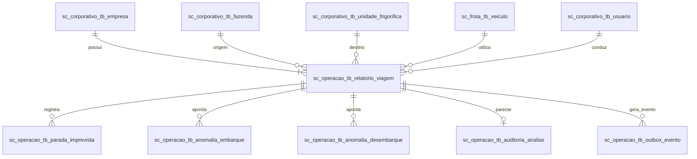

# Efficientia - Camada Relacional e Analítica (PostgreSQL / Supabase)

Este diretório contém a implementação do banco de dados relacional principal do ecossistema **Efficientia**, atuando como a **fonte única da verdade transacional (ACID)** para operações de transporte pecuário, bem-estar animal, auditoria de dados e camada analítica dimensional (*Star Schema*).

---

## 1. Visão Geral e Escopo Técnico

O banco de dados relacional é projetado para suportar operações logísticas contínuas de alta criticidade, garantindo:

* **Integridade Transacional Rigorosa (ACID)**: Rastreamento completo de cada lote bovino desde o embarque na fazenda até o abate no frigorífico com validações estritas de Guias de Trânsito Animal (GTA).
* **Segregação Lógica por Schemas**: Divisão de responsabilidades em esquemas bem definidos (`sc_corporativo`, `sc_frota`, `sc_operacao`, `sc_auditoria`), isolando domínios operacionais e minimizando o acoplamento.
* **Padrão Transactional Outbox**: Captura automática de mudanças de estado em viagens para publicação assíncrona e confiável em filas de mensageria, sem depender de two-phase commits (2PC).
* **Camada Analítica Integrada (Star Schema)**: Views dimensionais e tabelas fato otimizadas para geração de relatórios operacionais, análise de mortalidade e dashboards executivos.

---

## 2. Estrutura Estratégica de Diretórios

A organização interna segue uma sequência de construção incremental e modular:

```text
01_postgresql/
├── .env.example                     # Parâmetros de conexão (Direct Connection e Session Pooler)
├── README.md                        # Documentação técnica e guia de implantação relacional
├── modelo_logico.pdf                # Diagrama do modelo lógico de dados compilado
├── modelo_logico_dbdiagram.dbml     # Código-fonte declarativo para dbdiagram.io / DBML
│
├── 01_ddl/                          # Definição de Estruturas (DDL)
│   ├── 01_schemas_e_tipos.sql       # Criação dos schemas e tipos enumerados (ENUMs)
│   ├── 02_catalogo_e_auditoria.sql  # Dicionário de dados, catálogo de governança e trilha de auditoria
│   ├── 03_corporativo_e_frota.sql   # Entidades corporativas, endereços, fazendas, frigoríficos e veículos
│   └── 04_tabelas_transacionais.sql # Relatórios de viagem, ocorrências, anomalias e outbox
│
├── 02_constraints_and_indexes/      # Integridade e Otimização
│   └── 01_keys_e_indexes.sql        # Chaves estrangeiras, isolamento multi-tenant e índices compostos
│
├── 03_views/                        # Camada Dimensional e BI
│   └── 01_datamart_bi.sql           # Star Schema (dimensões, fato transporte e materialized view)
│
├── 04_functions/                    # Lógica Procedural
│   ├── 01_fn_registrar_auditoria.sql    # Trigger function de auditoria imutável genérica
│   ├── 02_fn_registrar_dau.sql          # Monitoramento de usuários ativos diários (DAU)
│   ├── 03_fn_validar_alocacao_viagem.sql # Validação de exclusividade e alocação de frota
│   └── 04_fn_gerar_outbox_relatorio.sql # Publicação de eventos no padrão Transactional Outbox
│
├── 05_triggers/                     # Gatilhos Automáticos
│   ├── 01_tg_auditoria.sql          # Triggers associadas às tabelas para captura de DML
│   └── 02_tg_validacoes_operacionais.sql # Triggers de consistência antes de INSERT/UPDATE
│
├── 06_procedures/                   # Transações Procedurais Críticas
│   ├── 01_sp_aprovar_relatorio.sql  # Procedure de homologação de viagem com trava de concorrência
│   └── 02_sp_registrar_anomalia.sql # Procedure de apontamento rápido com transação atômica
│
└── 07_dataload/                     # Carga Inicial de Dados (DML Modular)
    ├── 01_carga_catalogo_dados.sql  # Metadados do catálogo de dados corporativo
    ├── 02_carga_corporativo.sql     # Empresas, usuários, perfis e endereços
    ├── 03_carga_frota_e_dominios.sql# Fazendas, frigoríficos, frotas e tipos de anomalias
    ├── 04_carga_relatorios_viagem.sql # 1.500 relatórios de transporte animal verossímeis
    ├── 05_carga_paradas_e_anomalias.sql # Paradas imprevistas e anomalias de embarque/desembarque
    ├── 06_carga_auditoria_analise.sql # Pareceres técnicos veterinários e auditorias concluídas
    ├── 07_carga_outbox_eventos.sql  # Eventos transacionais sincronizados para a mensageria
    └── 08_carga_monitoramento_dau.sql # Métricas de engajamento e usuários ativos diários
```

---

## 3. Decisões Arquiteturais e Modelagem Relacional

### Segregação de Schemas
* **`sc_corporativo`**: Contém os limites da organização multi-tenant (`tb_empresa`, `tb_usuario`, `tb_perfil`, `tb_endereco`, `tb_fazenda`, `tb_unidade_frigorifica`).
* **`sc_frota`**: Gestão de ativos rodoviários (`tb_veiculo`, `tb_compartimento_carga`) e telemetria estática.
* **`sc_operacao`**: Domínio central de transporte pecuário (`tb_relatorio_viagem`, `tb_parada_imprevista`, `tb_anomalia_embarque`, `tb_anomalia_desembarque`, `tb_auditoria_analise`, `tb_outbox_evento`).
* **`sc_auditoria`**: Trilha imutável de operações (`tb_auditoria_log`) e telemetria de adoção (`tb_monitoramento_dau`).

### Topologia Relacional Simplificada



---

## 4. Dicionário de Schemas, Tabelas e Camada Dimensional

### Tabelas Principais por Schema

| Schema | Tabela | Descrição Técnica | Identificador |
| :--- | :--- | :--- | :--- |
| `sc_corporativo` | `tb_empresa` | Empresas operadoras de transporte e frigoríficos | UUID (PK) |
| `sc_corporativo` | `tb_usuario` | Motoristas, manobristas, curraleiros e analistas SIF | UUID (PK) |
| `sc_corporativo` | `tb_fazenda` | Propriedades rurais cadastradas para embarque pecuário | UUID (PK) |
| `sc_corporativo` | `tb_unidade_frigorifica` | Plantas industriais de processamento frigorífico | UUID (PK) |
| `sc_frota` | `tb_veiculo` | Cavalos mecânicos e carretas boiadeiras com tara e eixos | UUID (PK) |
| `sc_operacao` | `tb_relatorio_viagem` | Diário de rota com condições de transporte e integridade | UUID (PK) |
| `sc_operacao` | `tb_parada_imprevista` | Registro temporal e geográfico de retenções na estrada | UUID (PK) |
| `sc_operacao` | `tb_auditoria_analise` | Parecer veterinário formal para liberação da carga | UUID (PK) |
| `sc_operacao` | `tb_outbox_evento` | Tabela transactional outbox para despacho assíncrono | UUID (PK) |
| `sc_auditoria` | `tb_auditoria_log` | Trilha de auditoria gerada por triggers em operações DML | BIGSERIAL (PK) |
| `sc_auditoria` | `tb_monitoramento_dau` | Registros diários de acesso por usuário para métricas | UUID (PK) |

### Camada Dimensional (Data Mart BI)
* **`sc_operacao.dim_tempo`**: Dimensão temporal baseada nas datas de embarque.
* **`sc_operacao.dim_fazenda`**: Dimensão de propriedades rurais de origem com localização e porte.
* **`sc_operacao.dim_frigorifico`**: Dimensão de plantas industriais frigoríficas de destino.
* **`sc_operacao.dim_veiculo`**: Dimensão de frotas e tipos de implemento boiadeiro.
* **`sc_operacao.dim_motorista`**: Dimensão de condutores com categoria e histórico de conformidade.
* **`sc_operacao.vw_fato_transporte_animal`**: Tabela fato analítica consolidando volume de animais, taxa de mortalidade, emergências e tempo total de percurso.
* **`sc_operacao.mv_analise_mortalidade_mensal`**: Materialized View agregando taxas de mortalidade por mês, transportador e rota para reconciliação de placares.

---

## 5. Configuração de Ambiente e Conexão (.env e Supabase)

O acesso ao PostgreSQL pode ser configurado tanto localmente quanto por meio da infraestrutura de conexão do Supabase.

Copie o arquivo `.env.example` para `.env` e configure conforme as portas recomendadas:

```bash
cp 01_postgresql/.env.example 01_postgresql/.env
```

### Arquitetura de Portas do Supabase
* **Porta 5432 (Session Pooler / Conexão Direta)**:
  * Obrigatória para execução dos scripts DDL, compilação de views, triggers, criação de schemas e execuções que utilizem `SET session_replication_role` ou transações manuais (`BEGIN / COMMIT`).
* **Porta 6543 (Transaction Pooler - PgBouncer)**:
  * Recomendada para aplicações web stateless de alta frequência de conexões curtas (APIs REST). Não deve ser utilizada para compilação de DDL ou scripts de migração.

---

## 6. Roteiro de Compilação e Ordem Estrita de Execução

Para implantar o banco de dados a partir do estado inicial, execute os arquivos na ordem numérica estrita:

1. **`01_ddl/`**:
   * `01_schemas_e_tipos.sql`: Define schemas (`sc_auditoria`, `sc_corporativo`, `sc_frota`, `sc_operacao`) e enumeradores.
   * `02_catalogo_e_auditoria.sql`: Cria o catálogo de governança e a tabela central de auditoria imutável.
   * `03_corporativo_e_frota.sql`: Cria as tabelas de pessoas, empresas, propriedades rurais e frota.
   * `04_tabelas_transacionais.sql`: Cria o diário de viagem, ocorrências, anomalias e outbox de eventos.

2. **`02_constraints_and_indexes/`**:
   * `01_keys_e_indexes.sql`: Aplica chaves estrangeiras, restrições de unicidade e índices de alta performance compostos por tenant (`empresa_id`).

3. **`03_views/`**:
   * `01_datamart_bi.sql`: Compila as dimensões, a tabela fato e as materialized views analíticas.

4. **`04_functions/`**:
   * Compila as funções de auditoria automática, cálculo de métricas de uso e validação preventiva de frota.

5. **`05_triggers/`**:
   * Vincula os gatilhos de auditoria e consistência operacional às tabelas críticas.

6. **`06_procedures/`**:
   * `01_sp_aprovar_relatorio.sql`: Homologação veterinária com locks transacionais.
   * `02_sp_registrar_anomalia.sql`: Registro de inconformidades de embarque ou transporte.

7. **`07_dataload/`**:
   * Executar sequencialmente os scripts de carga de dados:
     * `01_carga_catalogo_dados.sql`: Metadados do catálogo.
     * `02_carga_corporativo.sql`: Empresas, usuários e endereços.
     * `03_carga_frota_e_dominios.sql`: Fazendas, frigoríficos e carretas.
     * `04_carga_relatorios_viagem.sql`: Diários de transporte pecuário.
     * `05_carga_paradas_e_anomalias.sql`: Paradas em trânsito e anomalias de rampa.
     * `06_carga_auditoria_analise.sql`: Pareceres e laudos de liberação.
     * `07_carga_outbox_eventos.sql`: Eventos para fila de mensageria.
     * `08_carga_monitoramento_dau.sql`: Métricas de usuários ativos diários.

---

## 7. Governança, Idempotência e Integridade Concorrencial

* **Padrão Multi-Tenant**: O isolamento de dados é reforçado pela presença obrigatória de `empresa_id` em consultas e índices B-Tree compostos com a chave primária.
* **Idempotência Estrutural**: Todos os arquivos de DDL utilizam cláusulas `CREATE SCHEMA IF NOT EXISTS`, `CREATE TABLE IF NOT EXISTS` e procedimentos baseados em blocos declarativos `DO $$ ... $$`.
* **Controle de Concorrência**: Aprovações de viagem utilizam técnicas de travamento transacional explícito (`FOR UPDATE`) para prevenir condições de corrida em relatórios homologados simultaneamente.
* **Auditoria de Conformidade**: Triggers automáticas registram toda operação de `INSERT`, `UPDATE` e `DELETE` em formato JSONB imutável com carimbo temporal e usuário de sessão.
