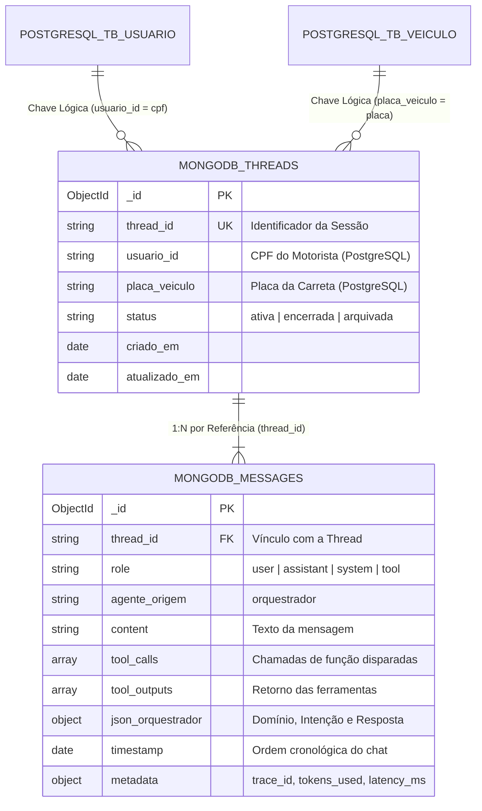

# Efficientia - Camada Conversacional e Não-Estruturada (MongoDB)

**Módulo:** `03_mongodb/`  
**História:** MD-50 / EFFICIENTI-306 (`[Sprint 08] [Mínimo] Usar MongoDB em uma interação conversacional`)  
**Tecnologia:** MongoDB (BSON / JSON Document Model)

---

## 1. Visão Geral e Propósito

No ecossistema **Efficientia**, os motoristas e operadores de transporte pecuário interagem diretamente com um **Agente de IA (Orquestrador)** pelo aplicativo mobile para esclarecer dúvidas de preenchimento, consultar telemetria de baia e relatar ocorrências em tempo de viagem.

Para esse caso de uso, o **MongoDB** foi selecionado como banco de dados NoSQL orientado a documentos devido às seguintes características inerentes às cargas de trabalho de Inteligência Artificial Generativa e LLMs:

1. **Polimorfismo de Mensagens:** Mensagens de usuário contêm texto simples; mensagens da IA contêm metadados complexos, categorização hierárquica de intenção/domínio (`json_orquestrador`), chamadas de funções (`tool_calls`) e seus respectivos retornos (`tool_outputs`).
2. **Evolução de Esquema sem Migrações Rígidas:** Novos modelos, parâmetros e provedores de IA podem introduzir metadados adicionais sem necessidade de comandos `ALTER TABLE` que causariam locks em tabelas relacionais.
3. **Escrita em Alta Frequência:** Ingestão rápida de turnos de diálogo em formato *append-only* com latência sub-milissegundo.

---

## 2. Decisão Arquitetural: Padrão de Referência vs. Embutimento

Na modelagem documental, avaliou-se entre manter todas as mensagens dentro de um array na própria thread (*Embedded Pattern*) versus separar em coleções vinculadas por chave (*Subset / Referenced Pattern*):



### Por que adotamos o Padrão de Referência (`threads` + `messages`)?
* **Evitar o limite de 16MB do BSON:** Em conversas longas ou com múltiplos turnos e anexos, um documento de thread embutido poderia crescer descontroladamente (*Unbounded Array Anti-Pattern*).
* **Mitigar Amplificação de Escrita (*Write Amplification*):** No modelo embutido, a cada nova mensagem o MongoDB precisaria realocar e regravar o documento inteiro em disco à medida que ele cresce. Com documentos independentes em `messages`, cada inserção é um novo bloco isolado.
* **Janelas de Contexto para LLMs:** Permite recuperar apenas as últimas $N$ mensagens necessárias para montar a janela de contexto do LLM (`db.messages.find().sort({ timestamp: 1 }).limit(10)`), sem trafegar mensagens desnecessárias pela rede.

---

## 3. Estrutura dos Arquivos

| Arquivo | Descrição |
| :--- | :--- |
| [`01_schema_validation.js`](./01_schema_validation.js) | Definição das coleções `threads` e `messages` usando regras estritas de validação via `$jsonSchema`. |
| [`02_indexes.js`](./02_indexes.js) | Criação de índices únicos e compostos (`thread_id + timestamp`, `usuario_id + status`, `metadata.trace_id`). |
| [`03_seed_conversations.js`](./03_seed_conversations.js) | Carga de dados de teste (sessão `eficientia_sessao_001` com dúvidas de embarque e `eficientia_sessao_002` com telemetria). |
| [`04_conversational_queries.js`](./04_conversational_queries.js) | Scripts de consulta para montagem de contexto LLM, métricas de tokens/latência e categorização de intenções. |

---

## 4. Estratégia de Indexação e Performance

| Coleção | Índice | Finalidade / Justificativa |
| :--- | :--- | :--- |
| `threads` | `{ thread_id: 1 }` (Unique) | Unicidade obrigatória da sessão conversacional. |
| `threads` | `{ usuario_id: 1, status: 1 }` | Recuperação em $O(1)$ da sessão ativa do motorista ao abrir o aplicativo. |
| `threads` | `{ placa_veiculo: 1 }` | Rastreamento de atendimentos gerados por determinada carreta. |
| `threads` | `{ atualizado_em: -1 }` | Listagem das sessões mais recentes para o suporte operacional. |
| `messages` | `{ thread_id: 1, timestamp: 1 }` | **Índice Crítico**: ordenação cronológica do chat sem operação de sort em memória. |
| `messages` | `{ "metadata.trace_id": 1 }` | Auditoria, observabilidade distribuída e rastreamento com APM/logs. |
| `messages` | `{ "json_orquestrador.dominio": 1, "json_orquestrador.intencao": 1 }` | Agregações de inteligência de frota e FAQ operacional. |

---

## 5. Como Executar

Os scripts foram desenvolvidos em JavaScript compatível tanto com o **MongoDB Shell (`mongosh`)** quanto com a aba de scripts do **MongoDB Compass**.

### Execução via Linha de Comando (`mongosh`):

```bash
# 1. Aplicar validação de schema
mongosh mongodb://localhost:27017/efficientia_ai 01_schema_validation.js

# 2. Criar os índices de performance
mongosh mongodb://localhost:27017/efficientia_ai 02_indexes.js

# 3. Executar a carga de dados iniciais (Seed)
mongosh mongodb://localhost:27017/efficientia_ai 03_seed_conversations.js

# 4. Executar as consultas e agregações analíticas
mongosh mongodb://localhost:27017/efficientia_ai 04_conversational_queries.js
```

---

## 6. Casos de Uso e Consultas Demonstradas

1. **Recuperação de Contexto Conversacional:** Carrega as mensagens de uma sessão em ordem cronológica estrita para composição do prompt do agente.
2. **Sessão Ativa com Preview da Última Mensagem:** Utiliza `$lookup` otimizado para devolver ao aplicativo mobile o estado atual do atendimento do motorista.
3. **Observabilidade e FinOps da IA:** Agregação que monitora consumo total de tokens, média por turno e percentis de latência ($ms$) do orquestrador.
4. **Inteligência Operacional da Frota:** Agrupamento por domínio (`motorista`, `telemetria`) e intenção para evidenciar as maiores dores e dúvidas recorrentes dos motoristas durante o transporte.
