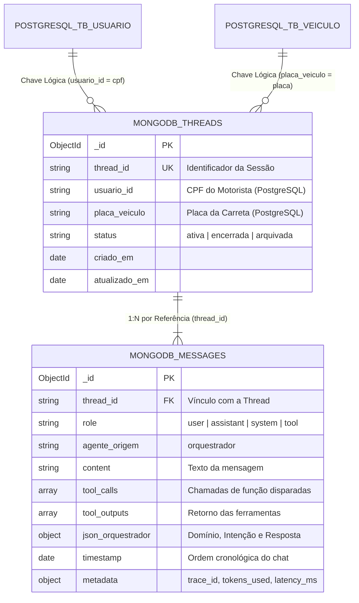

# Efficientia - Camada Conversacional e Dados Não Estruturados (MongoDB)

Este diretório contém a modelagem documental e os scripts do banco NoSQL orientado a documentos (**MongoDB**) do ecossistema **Efficientia**, responsável por gerenciar as sessões de chat, telemetria de tokens, histórico de interação e chamadas de ferramentas (*tool calls*) entre os motoristas e o **Agente de Inteligência Artificial (Orquestrador)**.

---

## 1. Visão Geral e Escopo Técnico

Durante o transporte pecuário, os motoristas utilizam o aplicativo mobile para esclarecer dúvidas de preenchimento de diários de bordo, consultar instruções sanitárias de embarque, checar limites de permanência na estrada e reportar anomalias em tempo real.

O MongoDB atende a este domínio devido a características essenciais para dados conversacionais e interações com Grandes Modelos de Linguagem (LLMs):

* **Polimorfismo Estrutural de Mensagens**: Mensagens emitidas por usuários consistem em texto simples; mensagens geradas pelo orquestrador contêm classificação hierárquica de intenção (`json_orquestrador`), chamadas de funções operacionais (`tool_calls`) e retornos estruturados (`tool_outputs`).
* **Evolução de Esquema sem Migrações Rígidas**: A adoção de novos modelos, provedores de inferência e parâmetros adicionais de telemetria ocorre sem a necessidade de comandos de DDL (`ALTER TABLE`) que causariam bloqueios (*locks*) no banco relacional.
* **Ingestão em Alta Frequência com Padrão Append-Only**: Gravação ultrarrápida de turnos de conversa com baixa latência e sem disputas de transação.

---

## 2. Estrutura Estratégica de Diretórios

A camada é composta por scripts declarativos em JavaScript para execução direta no MongoDB Shell (`mongosh`) ou no MongoDB Compass:

```text
03_mongodb/
├── README.md                        # Documentação técnica e guia de modelagem documental
├── 01_schema_validation.js          # Definição estrita de coleções e regras via $jsonSchema
├── 02_indexes.js                    # Criação de índices únicos, compostos e ordenação temporal
├── 03_seed_conversations.js         # Carga de sessões de teste e diálogos com o orquestrador
└── 04_conversational_queries.js     # Consultas de contexto para LLM, FinOps e análise de dores
```

---

## 3. Decisões Arquiteturais e Padrão de Modelagem

### Padrão de Referência (*Referenced Pattern*) vs. Embutimento (*Embedded Pattern*)
Na modelagem da interação conversacional, optou-se pela separação em duas coleções conectadas por identificador de sessão (`threads` e `messages`), em detrimento de armazenar todas as mensagens dentro de um array na própria thread:



### Justificativas Técnicas da Decisão:
1. **Prevenção do Limite de 16MB do BSON**: Em conversas com anexos de imagens de laudos ou múltiplos turnos de diálogo, o embutimento contínuo de mensagens provocaria o antipadrão de crescimento descontrolado (*Unbounded Array Anti-Pattern*).
2. **Mitigação de Amplificação de Escrita (*Write Amplification*)**: No modelo embutido, cada novo turno de mensagem obriga o motor do MongoDB a realocar e regravar o documento inteiro em disco. Com coleções separadas, cada mensagem é um documento novo e isolado.
3. **Paginação Eficiente de Janela de Contexto**: Permite que o orquestrador recupere apenas as últimas $N$ mensagens necessárias para montar o prompt do LLM (`db.messages.find().sort({ timestamp: 1 }).limit(10)`), sem trafegar históricos antigos pela rede.

---

## 4. Dicionário de Coleções e Validação de Schema

### Especificação das Coleções

| Coleção | Identificador | Responsabilidade | Validação |
| :--- | :--- | :--- | :--- |
| `threads` | `thread_id` (String / UK) | Representa a sessão de atendimento do motorista com vínculo aos dados relacionais do PostgreSQL | Validador `$jsonSchema` com controle de status |
| `messages` | `_id` (ObjectId / PK) | Turno individual de mensagem com emissor, conteúdo, metadados e chamadas de ferramenta | Validador `$jsonSchema` com controle de roles e datas |

### Estratégia de Índices e Performance

| Coleção | Índice | Complexidade | Justificativa de Engenharia |
| :--- | :--- | :--- | :--- |
| `threads` | `{ thread_id: 1 }` (Unique) | $O(1)$ | Garante unicidade absoluta do identificador da sessão |
| `threads` | `{ usuario_id: 1, status: 1 }` | $O(1)$ | Recuperação imediata da sessão ativa do motorista na abertura do aplicativo |
| `threads` | `{ placa_veiculo: 1 }` | $O(\log N)$ | Rastreamento de chamados abertos associados a determinado veículo |
| `threads` | `{ atualizado_em: -1 }` | $O(\log N)$ | Ordenação eficiente para painéis de suporte operacional |
| `messages` | `{ thread_id: 1, timestamp: 1 }` | $O(\log N)$ | **Índice Crítico**: Recuperação cronológica do diálogo sem ordenação em memória |
| `messages` | `{ "metadata.trace_id": 1 }` | $O(1)$ | Rastreabilidade distribuída com ferramentas de APM e correlação de logs |
| `messages` | `{ "json_orquestrador.dominio": 1, "json_orquestrador.intencao": 1 }` | $O(\log N)$ | Agregações analíticas de dores operacionais e frequência de temas |

---

## 5. Configuração de Ambiente e Conexão

O acesso ao MongoDB pode ser realizado por meio de um cluster local (Docker ou serviço nativo) ou instância na nuvem (MongoDB Atlas).

A string de conexão padrão segue o formato:
```text
mongodb://[usuario:senha@]localhost:27017/efficientia_ai[?opcoes]
```

### Ferramentas Recomendadas
* **MongoDB Shell (`mongosh`)**: Linha de comando oficial para execução automatizada de scripts.
* **MongoDB Compass**: Interface visual oficial para inspeção de documentos, visualização do validador `$jsonSchema` e execução do pipeline de agregação.

---

## 6. Roteiro e Ordem Estrita de Execução dos Scripts

Para configurar o banco conversacional e executar as consultas analíticas, execute os scripts na sequência:

```bash
# 1. Aplicar a validação estrita de schema ($jsonSchema):
mongosh mongodb://localhost:27017/efficientia_ai 01_schema_validation.js

# 2. Criar os índices únicos e compostos de performance:
mongosh mongodb://localhost:27017/efficientia_ai 02_indexes.js

# 3. Executar a carga de dados iniciais de teste (Seed):
mongosh mongodb://localhost:27017/efficientia_ai 03_seed_conversations.js

# 4. Executar as consultas de contexto e agregações analíticas:
mongosh mongodb://localhost:27017/efficientia_ai 04_conversational_queries.js
```

---

## 7. Casos de Uso, Observabilidade e FinOps da IA

O arquivo `04_conversational_queries.js` demonstra quatro casos de uso centrais da arquitetura conversacional:

1. **Recuperação de Janela de Contexto para LLM**: Consulta otimizada por índice composto que recupera os últimos turnos em ordem cronológica para injeção no prompt de atendimento.
2. **Sessão Ativa com Preview da Última Mensagem**: Utiliza o operador `$lookup` otimizado para retornar a sessão atual do motorista acompanhada do último texto trocado, exibindo previews no aplicativo mobile sem leituras redundantes.
3. **Observabilidade e FinOps da IA**: Pipeline de agregação (`$group`, `$sum`, `$avg`) que computa o consumo total de tokens de entrada e saída, média de consumo por turno e percentis de latência de resposta em milissegundos ($ms$).
4. **Inteligência Operacional da Frota**: Agrupamento por domínio (`motorista`, `telemetria`, `bem_estar_animal`) e intenção para identificar as maiores dúvidas e incidentes recorrentes reportados pelos condutores durante a viagem.
