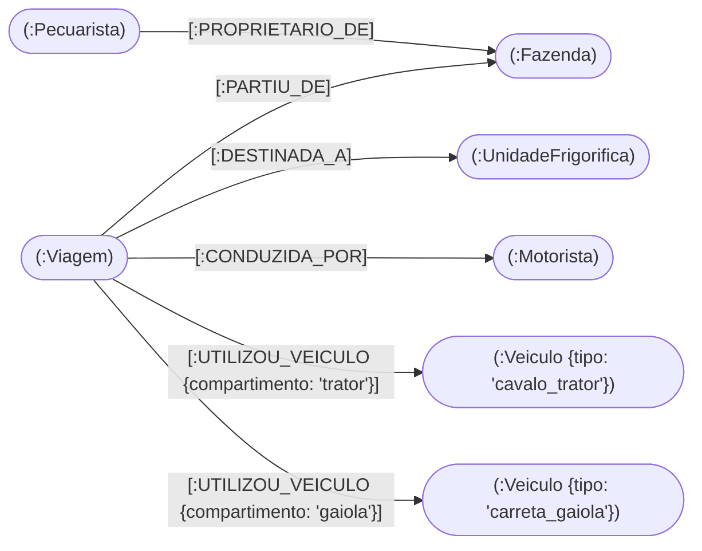
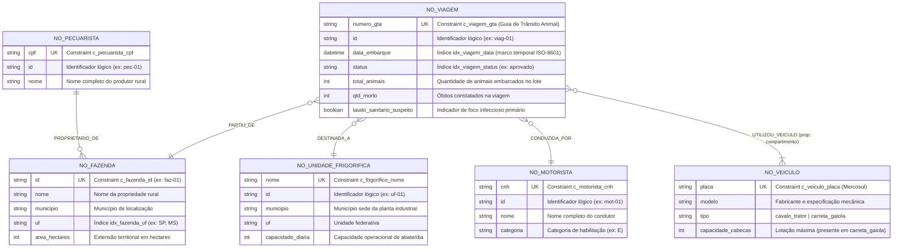

# Efficientia - Modelagem em Grafo e Rastreabilidade Sanitária (Neo4j)

Módulo responsável pela representação topológica da malha logística pecuária, rastreamento epidemiológico de contatos indiretos (*Contact Tracing*), detecção de vetores de contaminação cruzada por desacoplamento de implementos rodoviários e análise de centralidade de risco sanitário da plataforma **Efficientia**, implementado em **Cypher** sobre o modelo de grafo de propriedades (*Property Graph Model*) do **Neo4j**.

---

## 1. Visão Geral e Escopo Estratégico

Na logística de transporte de animais vivos, um caminhão boiadeiro raramente opera como um bloco monolítico: cavalos mecânicos (tratores) e carretas boiadeiras (gaiolas) são constantemente acoplados e desacoplados entre diferentes rotas, motoristas, fazendas fornecedoras e unidades frigoríficas em múltiplos estados. Quando um lote desembarcado apresenta suspeita sanitária ou foco infeccioso (como febre aftosa, brucelose ou doenças vesiculares), os órgãos de defesa agropecuária exigem o isolamento imediato de toda a cadeia exposta.

Em bancos relacionais tradicionais, rastrear contaminações indiretas em profundidade arbitrária ($N$ viagens subsequentes intercaladas por trocas de carretas e cavalos) exige autojunções recursivas (`WITH RECURSIVE`) cujo custo computacional cresce exponencialmente com o número de saltos. No **Neo4j**, graças à arquitetura de **Adjacência Livre de Índice (*Index-Free Adjacency*)**, cada nó mantém ponteiros físicos diretos para seus relacionamentos incidentes, permitindo travessias multissalto em tempo proporcional apenas ao subgrafo visitado.

O escopo construído neste diretório compreende três artefatos Cypher completos:

1. **Integridade de Esquema e Índices de Travessia (`01_schema_constraints.cypher`)**: Definição de 6 restrições formais de unicidade (`IS UNIQUE`) para todas as entidades do domínio e 3 índices secundários voltados à poda temporal e geográfica durante a navegação na malha.
2. **Simulação Epidemiológica e Malha Logística (`02_seed_data.cypher`)**: Construção de um grafo realista composto por 18 nós e 29 relacionamentos direcionados abrangendo São Paulo e Mato Grosso do Sul, simulando foco primário, contágio por reutilização de conjunto veicular, disseminação interestadual, rota limpa de controle sanitário e contaminação por transbordo de carreta entre cavalos distintos.
3. **Consultas Analíticas de Travessia em Grafo (`03_traversal_queries.cypher`)**: Implementação de 3 algoritmos de negócio em Cypher para rastreamento epidemiológico temporal, cálculo de caminho mínimo de propagação (`shortestPath`) e ranking de grau de centralidade de equipamentos super-disseminadores.

---

## 2. Estrutura Arquitetural de Diretórios

Os scripts `.cypher` estão organizados na sequência lógica de criação de restrições, povoamento do grafo e execução analítica:

```text
04_neo4j/
├── README.md                                     # Documentação técnica completa e modelo conceitual em grafo
├── 01_schema_constraints.cypher                  # 6 constraints de unicidade e 3 índices secundários de busca
├── 02_seed_data.cypher                           # Carga idempotente da malha logística e cenário epidemiológico
├── 03_traversal_queries.cypher                   # Consultas Cypher de Contact Tracing, shortestPath e centralidade
│
├── 04_projection/                                # Projeções incrementais do Transactional Outbox (PostgreSQL -> Neo4j)
│   ├── upsert_propriedade_e_frigorifico.cypher   # Projeção parametrizada de fazendas e unidades industriais
│   ├── upsert_frota_e_motorista.cypher           # Projeção parametrizada de condutores e veículos
│   ├── upsert_viagem_aprovada.cypher             # Materialização de viagem e topologia relacional de rota
│   └── remover_viagem_cancelada.cypher           # Desmaterialização (DETACH DELETE) de viagens estornadas
│
├── 05_rollback/                                  # Scripts para desfazimento total do grafo
│   └── drop_everything.cypher                    # Exclusão segura de nós, relacionamentos, constraints e índices
│
└── tests/                                        # Baterias de validação automatizada
    └── check_neo4j.sh                            # Script bash de execução e validação contínua via cypher-shell
```

---

## 3. Modelo Conceitual

No paradigma de **Grafo de Propriedades (*Property Graph Model*)**, a informação é estruturada em três cidadãos de primeira classe: **Nós (*Nodes*)** categorizados por rótulos (*Labels*), **Relacionamentos direcionados e tipados (*Relationships*)** que conectam pares de nós, e **Propriedades chave-valor (*Properties*)** armazenadas tanto nos nós quanto nos próprios relacionamentos.

O nó `(:Viagem)` atua como **hiperaresta reificada (evento logístico central)**, conectando no tempo e no espaço a propriedade de origem, a planta frigorífica de destino, o condutor habilitado e os dois módulos físicos do veículo (trator e gaiola).

### 3.1 Diagrama Conceitual Topológico de Nós e Relacionamentos



### 3.2 Diagrama Conceitual Detalhado de Rótulos, Chaves, Relacionamentos e Propriedades



---

## 4. Arquitetura Técnica e Fluxo de Funcionamento

### 4.1 Modelagem Desacoplada de Cavalo Mecânico e Carreta Boiadeira

Cada nó `(:Viagem)` estabelece duas arestas independentes `[:UTILIZOU_VEICULO]` apontando para nós `(:Veiculo)` distintos, diferenciadas pela propriedade de relacionamento `compartimento` (`"trator"` ou `"gaiola"`). Essa decisão arquitetural permite que o motor de grafos detecte contágios indiretos mesmo quando uma carreta contaminada é desengatada de seu cavalo original e acoplada a um cavalo mecânico completamente limpo em outra cidade ou estado.

### 4.2 Dinâmica Temporal do Cenário Epidemiológico Simulado (`02_seed_data.cypher`)

O conjunto de dados carregado modela cinco viagens sequenciais entre `01/10/2026` e `05/10/2026` para demonstrar precisão de rastreamento e ausência de falsos positivos:

```mermaid
flowchart TD
    subgraph Cadeia_Exposta ["Subgrafo Exposto ao Vetor GAI9X88 / BRA2E19"]
        F1["Fazenda Esperança (Lins/SP) - Foco Inicial"]
        V1["Viagem 1: GTA-SP-00101 (01/10 08:00) - Suspeito: true"]
        VEC_C1["Cavalo: BRA2E19"]
        VEC_G1["Carreta Gaiola: GAI9X88 (Vetor Primário)"]
        V2["Viagem 2: GTA-SP-00102 (02/10 09:30)"]
        V3["Viagem 3: GTA-MS-00201 (03/10 11:00) - Interestadual"]
        V5["Viagem 5: GTA-SP-00104 (05/10 14:00) - Troca de Cavalo"]
        F2["Fazenda Santa Maria (Araçatuba/SP)"]
        F4["Fazenda Boi Gordo (Três Lagoas/MS)"]
        UF1["Frigorífico JBS Lins (SP)"]
        UF2["Frigorífico JBS Andradina (SP)"]

        V1 -->|"[:PARTIU_DE]"| F1
        V1 -->|"[:DESTINADA_A]"| UF1
        V1 -->|"[:UTILIZOU_VEICULO]"| VEC_C1 & VEC_G1
        V2 & V3 -->|"[:UTILIZOU_VEICULO]"| VEC_C1 & VEC_G1
        V2 -->|"[:PARTIU_DE]"| F2
        V2 -->|"[:DESTINADA_A]"| UF1
        V3 -->|"[:PARTIU_DE]"| F4
        V3 -->|"[:DESTINADA_A]"| UF2
        V5 -->|"[:UTILIZOU_VEICULO {gaiola}]"| VEC_G1
        V5 -->|"[:PARTIU_DE]"| F2
        V5 -->|"[:DESTINADA_A]"| UF2
    end

    subgraph Rota_Controle_Limpa ["Subgrafo Isolado (Controle Negativo)"]
        F3["Fazenda São José (Andradina/SP)"]
        V4["Viagem 4: GTA-SP-00103 (04/10 07:15) - Rota Limpa"]
        VEC_C2["Cavalo: MER1A22"]
        VEC_G2["Carreta Gaiola: GAI4T10"]

        V4 -->|"[:PARTIU_DE]"| F3
        V4 -->|"[:UTILIZOU_VEICULO]"| VEC_C2 & VEC_G2
        V4 -->|"[:DESTINADA_A]"| UF2
        V5 -->|"[:UTILIZOU_VEICULO {trator}]"| VEC_C2
    end
```



* **Viagem 1 (`GTA-SP-00101` — `01/10`)**: Parte da `Fazenda Esperança` com `laudo_sanitario_suspeito: true` e `2` óbitos, contaminando o cavalo `BRA2E19` e a carreta `GAI9X88`.
* **Viagem 2 (`GTA-SP-00102` — `02/10`)**: Reutiliza o mesmo conjunto `BRA2E19` + `GAI9X88` no dia seguinte a partir da `Fazenda Santa Maria`, expondo a propriedade por contato indireto de rampa.
* **Viagem 3 (`GTA-MS-00201` — `03/10`)**: Leva o conjunto contaminado até `Três Lagoas/MS` (`Fazenda Boi Gordo`) e descarrega no `Frigorífico JBS Andradina`, propagando o risco através da divisa estadual.
* **Viagem 4 (`GTA-SP-00103` — `04/10`)**: Rota de controle sanitário operada na `Fazenda São José` com o cavalo `MER1A22` (ainda limpo naquela data) e a carreta `GAI4T10`. Como o filtro temporal na travessia exige `v_exposta.data_embarque >= v_origem.data_embarque` sobre o vetor contaminado, a `Fazenda São José` não sofre quarentena indevida.
* **Viagem 5 (`GTA-SP-00104` — `05/10`)**: Demonstra o desacoplamento logístico — a carreta contaminada `GAI9X88` é acoplada ao cavalo `MER1A22`, mantendo a rastreabilidade de risco ativa.

---

## 5. Especificação Técnica e Catálogo de Componentes

### 5.1 Restrições de Unicidade e Índices (`01_schema_constraints.cypher`)

| Nome do Objeto | Tipo | Rótulo Alvo (`Label`) | Propriedade | Função Estrutural e de Performance |
| :--- | :--- | :--- | :--- | :--- |
| `c_fazenda_id` | `UNIQUE CONSTRAINT` | `:Fazenda` | `id` | Impede duplicidade de propriedades rurais e cria índice de ponto de entrada |
| `c_pecuarista_cpf` | `UNIQUE CONSTRAINT` | `:Pecuarista` | `cpf` | Assegura unicidade cadastral por documento fiscal do produtor |
| `c_motorista_cnh` | `UNIQUE CONSTRAINT` | `:Motorista` | `cnh` | Impede duplicidade de condutores habilitados na malha |
| `c_veiculo_placa` | `UNIQUE CONSTRAINT` | `:Veiculo` | `placa` | Garante nó único por placa para cavalos e carretas em `MERGE` |
| `c_viagem_gta` | `UNIQUE CONSTRAINT` | `:Viagem` | `numero_gta` | Assegura correspondência `1:1` com a Guia de Trânsito Animal oficial |
| `c_frigorifico_nome` | `UNIQUE CONSTRAINT` | `:UnidadeFrigorifica` | `nome` | Garante unicidade nominal das plantas receptoras |
| `idx_viagem_data` | `RANGE INDEX` | `:Viagem` | `data_embarque` | Acelera comparações cronológicas (`>=`) durante o *Contact Tracing* |
| `idx_viagem_status` | `RANGE INDEX` | `:Viagem` | `status` | Filtra rapidamente o estado operacional das viagens |
| `idx_fazenda_uf` | `RANGE INDEX` | `:Fazenda` | `uf` | Otimiza recortes regionais e barreiras sanitárias por estado |

### 5.2 Catálogo de Relacionamentos do Grafo

| Tipo de Relacionamento | Nó de Origem | Nó de Destino | Propriedades da Aresta | Semântica de Domínio |
| :--- | :--- | :--- | :--- | :--- |
| `[:PROPRIETARIO_DE]` | `(:Pecuarista)` | `(:Fazenda)` | *(nenhuma)* | Titularidade cadastral e responsabilidade legal sobre o rebanho |
| `[:PARTIU_DE]` | `(:Viagem)` | `(:Fazenda)` | *(nenhuma)* | Origem física do embarque do lote animal |
| `[:DESTINADA_A]` | `(:Viagem)` | `(:UnidadeFrigorifica)` | *(nenhuma)* | Planta industrial destinatária do desembarque |
| `[:CONDUZIDA_POR]` | `(:Viagem)` | `(:Motorista)` | *(nenhuma)* | Responsável técnico pela condução rodoviária da viagem |
| `[:UTILIZOU_VEICULO]` | `(:Viagem)` | `(:Veiculo)` | `compartimento` (`"trator"` \| `"gaiola"`) | Alocação física de unidade tratora ou implemento boiadeiro na viagem |

### 5.3 Consultas Analíticas de Travessia (`03_traversal_queries.cypher`)

| Consulta | Padrão de Travessia / Algoritmo Cypher | Resultado Entregue à Defesa Sanitária e Logística |
| :--- | :--- | :--- |
| **1. Rastreamento Epidemiológico e Contágio Cruzado** | `(origem:Fazenda)<-[:PARTIU_DE]-(v_origem:Viagem)-[:UTILIZOU_VEICULO]->(vetor:Veiculo)<-[:UTILIZOU_VEICULO]-(v_exposta:Viagem)-[:PARTIU_DE\|DESTINADA_A]->(entidade_em_risco)` com poda temporal `v_exposta.data_embarque >= v_origem.data_embarque` | Lista ordenada cronologicamente contendo GTA de origem, placa e tipo do veículo vetor, GTA contaminada subsequente e todas as fazendas e frigoríficos que exigem bloqueio/quarentena preventiva |
| **2. Caminho Mais Curto de Propagação (`shortestPath`)** | `shortestPath((origem)-[*..8]-(destino))` até 8 saltos entre `Fazenda Esperança` e `Frigorífico JBS Andradina` | Subgrafo visual, contagem exata de saltos (`total_saltos`) e sequência ordenada dos identificadores (`coalesce(n.nome, n.placa, n.numero_gta)`) que formaram a ponte de transmissão |
| **3. Hubs Logísticos e Grau de Centralidade de Risco** | `MATCH (veic:Veiculo)<-[:UTILIZOU_VEICULO]-(v:Viagem)` + `OPTIONAL MATCH` para fazendas e frigoríficos distintos | Placar ordenado por `score_centralidade_risco = fazendas_atendidas + frigorificos_atendidos`, destacando os veículos prioritários para desinfecção intensiva |

---

## 6. Requisitos e Configuração de Ambiente

### 6.1 Pré-Requisitos

* **Servidor Neo4j 5.0 ou superior** em execução local ou em servidor dedicado (protocolo `bolt://` na porta padrão `7687` e interface HTTP/HTTPS na porta `7474`).
* **Utilitário `cypher-shell`** instalado para execução automatizada por linha de comando, ou acesso à interface **Neo4j Browser** para inspeção visual interativa dos grafos gerados.

### 6.2 Parâmetros de Conexão Padrão

```ini
NEO4J_URI=bolt://localhost:7687
NEO4J_USER=neo4j
NEO4J_PASSWORD=sua_senha_segura
```

---

## 7. Roteiro de Implantação e Execução

### 7.1 Execução Sequencial via Linha de Comando (`cypher-shell`)

Execute os três arquivos na ordem exata abaixo a partir da raiz do repositório:

```bash
# 1. Criar as 6 constraints de unicidade e os 3 índices de busca
cypher-shell -a bolt://localhost:7687 -u neo4j -p sua_senha_segura -f 04_neo4j/01_schema_constraints.cypher

# 2. Carregar os nós e relacionamentos do cenário logístico e epidemiológico
cypher-shell -a bolt://localhost:7687 -u neo4j -p sua_senha_segura -f 04_neo4j/02_seed_data.cypher

# 3. Executar as 3 consultas de travessia, menor caminho e centralidade
cypher-shell -a bolt://localhost:7687 -u neo4j -p sua_senha_segura -f 04_neo4j/03_traversal_queries.cypher
```

### 7.2 Inspeção e Limpeza Segura em Ambiente de Desenvolvimento

Para validar o estado das restrições criadas ou reiniciar o grafo antes de um novo ciclo de testes:

```cypher
// Listar todas as constraints e índices ativos no catálogo do Neo4j
SHOW CONSTRAINTS;
SHOW INDEXES;

// Limpar apenas nós e arestas mantendo intactas as constraints e índices (apenas em testes)
MATCH (n) DETACH DELETE n;
```

---

## 8. Governança, Concorrência, Segurança e Qualidade

* **Idempotência Estrutural e Cadastral**: Todas as constraints e índices empregam a cláusula `IF NOT EXISTS`, e as entidades cadastrais mestras (`:UnidadeFrigorifica`, `:Pecuarista`, `:Fazenda`, `:Motorista`, `:Veiculo`) são instanciadas via `MERGE` ancorado em chaves únicas, evitando vértices duplicados na topologia.
* **Rigor Temporal na Causalidade Epidemiológica**: A consulta de *Contact Tracing* aplica tipos temporais nativos `datetime(...)` combinados à desigualdade `v_exposta.data_embarque >= v_origem.data_embarque`, impedindo que viagens realizadas por um caminhão *antes* do evento infeccioso sejam falsamente reportadas como contaminadas.
* **Limite Superior em Travessias Variáveis**: O uso explícito de limite máximo de profundidade `[*..8]` no cálculo de `shortestPath` protege a memória do servidor contra explosão combinatória em malhas densamente conectadas.
* **Aderência à Defesa Agropecuária**: O modelo vincula diretamente cada evento de deslocamento ao seu respectivo `numero_gta`, fornecendo rastreabilidade imediata por município e unidade federativa para emissão de alertas sanitários e interdições cirúrgicas de rampa.
