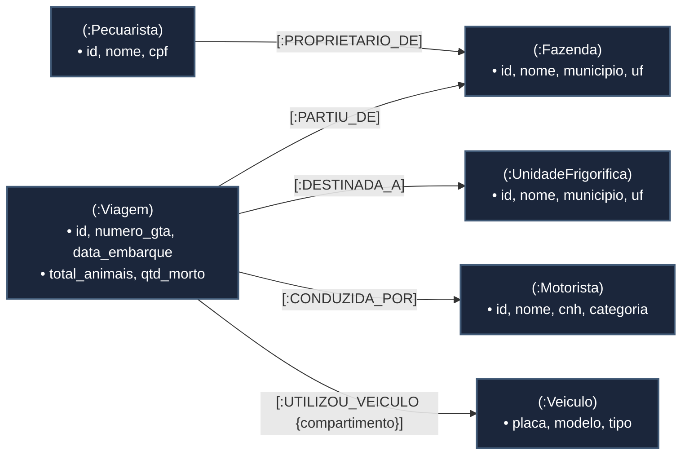

# Efficientia - Modelagem em Grafo e Rastreabilidade Epidemiológica (Neo4j)

Este diretório contém a modelagem em banco de dados orientado a grafos (**Property Graph Model**) do ecossistema **Efficientia**, desenvolvida para realizar análises avançadas de topologia pecuária, rastreabilidade sanitária de lotes e **travessias de rede (*Graph Traversal*)** na prevenção de contaminação cruzada entre fazendas, veículos e unidades frigoríficas.

---

## 1. Visão Geral e Escopo Técnico

No setor pecuário, a identificação de focos de doenças infectocontagiosas (como Febre Aftosa ou Tuberculose Bovina) exige rastreamento imediato de todos os vetores de contato. Como carretas boiadeiras e cavalos mecânicos são compartilhados entre viagens de diferentes propriedades, um veículo contaminado pode se tornar um disseminador em cadeia.

O módulo em Neo4j desempenha as seguintes funções técnicas:

* **Adjacência Livre de Índice (*Index-Free Adjacency*)**: Conexões entre fazendas, viagens, veículos e frigoríficos são armazenadas fisicamente como ponteiros em memória, permitindo saltos entre nós em tempo constante $O(1)$.
* **Rastreamento Epidemiológico (*Contact Tracing*)**: Capacidade de navegar por caminhos de comprimento variável sem o custo exponencial de múltiplas junções relacionais (*self-joins*).
* **Identificação de Hubs Logísticos**: Detecção de gargalos, motoristas de alto alcance e implementos rodoviários críticos por meio de análise de centralidade de rede.

---

## 2. Estrutura Estratégica de Diretórios

A modelagem em grafo é estruturada em arquivos declarativos Cypher prontos para execução no Neo4j Browser ou no console `cypher-shell`:

```text
04_neo4j/
├── README.md                        # Documentação técnica e guia da modelagem em grafo
├── 01_schema_constraints.cypher     # Restrições de unicidade e índices de propriedades
├── 02_seed_data.cypher              # Carga de malha pecuária com vetores de transmissão cruzada
└── 03_traversal_queries.cypher      # Consultas Cypher de Traversal, menor caminho e centralidade
```

---

## 3. Decisões Arquiteturais e Topologia do Grafo

### Diferencial Técnico: RDBMS vs. Property Graph
* **Bancos Relacionais (RDBMS)**: Conexões entre entidades são inferidas em tempo de consulta por meio de chaves estrangeiras (`FOREIGN KEY`), exigindo varreduras de índices e operações de junção (`JOIN`) computacionalmente caras que degradam exponencialmente com a profundidade da busca.
* **Bancos Orientados a Grafos (Neo4j)**: Os relacionamentos são entidades nativas de primeira classe com atributos próprios e ponteiros diretos, viabilizando travessias profundas com desempenho previsível.

### Topologia do Grafo de Propriedades



---

## 4. Dicionário Técnico de Nós e Relacionamentos

### 1. Nós (Labels)

| Rótulo (Label) | Descrição de Negócio | Propriedades Principais |
| :--- | :--- | :--- |
| **`:Fazenda`** | Propriedade rural produtora e local de embarque da boiada | `id`, `nome`, `municipio`, `uf`, `area_hectares` |
| **`:Pecuarista`** | Produtor rural proprietário da fazenda | `id`, `nome`, `cpf` |
| **`:Motorista`** | Condutor profissional habilitado para transporte pecuário | `id`, `nome`, `cnh`, `categoria` |
| **`:Veiculo`** | Equipamento de transporte (Cavalo trator ou Carreta boiadeira) | `placa`, `modelo`, `tipo` |
| **`:Viagem`** | Diário de percurso do lote com data, condições e mortalidade | `id`, `numero_gta`, `data_embarque`, `status`, `total_animais`, `qtd_morto` |
| **`:UnidadeFrigorifica`** | Planta industrial frigorífica de recepção e abate | `id`, `nome`, `municipio`, `uf`, `capacidade_diaria` |

### 2. Relacionamentos (Edges)

| Tipo de Conexão | Nó de Origem | Nó de Destino | Propriedades da Aresta |
| :--- | :--- | :--- | :--- |
| **`:PROPRIETARIO_DE`** | `:Pecuarista` | `:Fazenda` | Nenhuma (Aresta estrutural) |
| **`:PARTIU_DE`** | `:Viagem` | `:Fazenda` | Nenhuma (Conexão de origem) |
| **`:DESTINADA_A`** | `:Viagem` | `:UnidadeFrigorifica` | Nenhuma (Conexão de destino) |
| **`:CONDUZIDA_POR`** | `:Viagem` | `:Motorista` | Nenhuma (Vínculo de condução) |
| **`:UTILIZOU_VEICULO`** | `:Viagem` | `:Veiculo` | `compartimento: 'trator' \| 'gaiola'` |

---

## 5. Problema de Negócio e Análise de Traversal Sanitário

### A Pergunta Central de Negócio:
> *"Caso um lote de animais com suspeita de doença infectocontagiosa seja interceptado na recepção de um frigorífico, quais outras fazendas, carretas boiadeiras e plantas industriais estão sob risco imediato de contaminação cruzada por terem compartilhado os mesmos implementos rodoviários em viagens subsequentes?"*

### Por que o SQL Relacional Falha nesta Demanda:
* Responder a essa pergunta no modelo relacional tradicional requer encadear entre **7 e 10 junções consecutivas** (`JOIN`) em torno de `tb_relatorio_viagem`, com cláusulas temporais para garantir que a contaminação só se propague para viagens posteriores à data do contato.
* Quando a contaminação atravessa mais de dois saltos de profundidade (por exemplo: fazenda de origem -> carreta boiadeira -> fazenda intermediária -> novo cavalo mecânico -> segundo frigorífico), o SQL necessita de **expressões de tabela comuns recursivas (*Recursive CTEs*)** com verificação manual de ciclos em memória, degradando o tempo de resposta do banco.
* No Neo4j, o Traversal percorre diretamente os ponteiros das arestas em memória por meio de consultas declarativas em Cypher, respondendo com latência em milissegundos.

---

## 6. Roteiro e Ordem Estrita de Execução dos Scripts

Os scripts em Cypher estão preparados para execução direta no **Neo4j Browser** ou via console **`cypher-shell`**:

### Sequência de Execução:

1. **`01_schema_constraints.cypher`**:
   * Cria restrições de unicidade (`UNIQUE`) para identificadores naturais e de negócio (`numero_gta`, `cpf`, `cnh`, `placa`).
   * Cria índices de busca em propriedades frequentes de filtragem e janelas temporais (`data_embarque`).

2. **`02_seed_data.cypher`**:
   * Popula uma malha pecuária representativa com fazendas situadas em São Paulo e Mato Grosso do Sul, unidades industriais frigoríficas (Lins e Andradina), frota rodoviária e viagens encadeadas.
   * Cria intencionalmente o vetor de contaminação cruzada compartilhando a carreta boiadeira de placa `GAI9X88` para demonstração do algoritmo.

3. **`03_traversal_queries.cypher`**:
   * Executa os algoritmos de consulta de traversal para inspeção de rotas e determinação de quarentena.

---

## 7. Consultas Demonstradas e Métricas de Conectividade

O arquivo `03_traversal_queries.cypher` contém três consultas estratégicas de análise de grafos:

1. **Traversal de Contágio Cruzado e Quarentena Sanitária**:
   * Percorre a cadeia de viagens a partir de um frigorífico de alerta, identifica o veículo compartilhador e localiza todas as fazendas subsequentes que devem entrar em quarentena preventiva.
2. **Traversal de Menor Caminho de Infecção (*Shortest Path*)**:
   * Utiliza a função nativa `shortestPath()` com profundidade variável para traçar o caminho topológico mais curto percorrido pelo vetor infeccioso entre o lote contaminado e outras propriedades rurais.
3. **Análise de Centralidade e Hubs de Disseminação**:
   * Computa o grau de conexão de veículos e condutores para determinar quais ativos logísticos possuem maior potencial de propagação em caso de surto sanitário, auxiliando no planejamento preventivo de desinfecção e biosseguridade.
