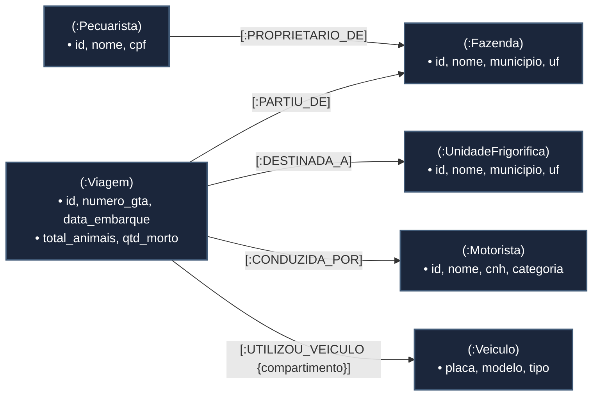

# Modelagem em Grafo e Consultas de Traversal com Neo4j

Este diretório contém a modelagem em banco de dados orientado a grafos (**Property Graph Model**) do ecossistema **Efficientia**, desenvolvida para atender à história **MD-52 (EFFICIENTI-308)**.

O objetivo central desta entrega é explorar a capacidade nativa de **Traversal** do Neo4j para responder a perguntas de negócio complexas que seriam inviáveis ou excessivamente lentas em bancos relacionais tradicionais.

---

## 🎯 Por que Grafo e o que é um Traversal?

Conforme abordado nos conceitos de banco de dados de grafos:
* Em bancos relacionais (RDBMS), relacionamentos entre entidades são inferidos através de chaves estrangeiras (`FOREIGN KEY`), exigindo operações dispendiosas de junção (`JOIN`) e varredura de índices em tempo de consulta.
* No **Neo4j**, os relacionamentos são entidades de primeira classe armazenadas fisicamente como ponteiros bidirecionais diretos entre nós (*Index-Free Adjacency*).

Um **Traversal** não é uma simples busca por nó (`MATCH (f:Fazenda) WHERE...`), mas sim o **percurso deliberado por múltiplos saltos de relacionamentos em cadeia**, descobrindo conexões indiretas, caminhos mínimos (*shortest paths*) e padrões topológicos através da malha logística.

---

## 🏛️ Modelagem do Grafo de Propriedades (Property Graph Model)

### Diagrama da Topologia do Grafo

---

## 📋 Dicionário de Entidades e Relacionamentos

### 1. Nós (Labels)
| Rótulo (Label) | Descrição | Principais Propriedades |
|---|---|---|
| **`:Fazenda`** | Propriedade rural de origem do gado | `id`, `nome`, `municipio`, `uf`, `area_hectares` |
| **`:Pecuarista`** | Produtor rural proprietário da fazenda | `id`, `nome`, `cpf` |
| **`:Motorista`** | Condutor responsável pelo transporte pecuário | `id`, `nome`, `cnh`, `categoria` |
| **`:Veiculo`** | Equipamento logístico (Cavalo mecânico ou Carreta Boiadeira) | `placa`, `modelo`, `tipo` |
| **`:Viagem`** | Relatório de transporte de carga viva (Diário de rota) | `id`, `numero_gta`, `data_embarque`, `status`, `total_animais`, `qtd_morto` |
| **`:UnidadeFrigorifica`**| Planta industrial de abate e processamento | `id`, `nome`, `municipio`, `uf`, `capacidade_diaria` |

### 2. Relacionamentos (Edges)
| Tipo de Conexão | De (Nó de Origem) | Para (Nó de Destino) | Propriedades da Aresta |
|---|---|---|---|
| **`:PROPRIETARIO_DE`** | `:Pecuarista` | `:Fazenda` | - |
| **`:PARTIU_DE`** | `:Viagem` | `:Fazenda` | - |
| **`:DESTINADA_A`** | `:Viagem` | `:UnidadeFrigorifica` | - |
| **`:CONDUZIDA_POR`** | `:Viagem` | `:Motorista` | - |
| **`:UTILIZOU_VEICULO`** | `:Viagem` | `:Veiculo` | `compartimento: 'trator' \| 'gaiola'` |

---

## 🧬 A Pergunta de Negócio que Exige Traversal

### Pergunta:
> **"Rastreamento Epidemiológico e Risco de Contágio Cruzado Sanitário (Contact Tracing):"**  
> *Caso um lote de animais com suspeita de doença infectocontagiosa (ex: Febre Aftosa ou Tuberculose Bovina) seja interceptado na recepção de um frigorífico, quais outras fazendas, veículos e lotes de outros frigoríficos estão em quarentena de risco por terem compartilhado os mesmos equipamentos em viagens subsequentes?*

### Por que o SQL Relacional Falha nessa Consulta?
* Para responder a essa pergunta em SQL, seriam necessários no mínimo **7 a 9 self-joins** encadeando viagens com viagens passadas, com filtragem temporal complexa.
* Se a contaminação passar por mais de 2 saltos (ex: a carreta foi engatada em outro cavalo que depois foi para outro estado), o SQL exige **CTEs recursivas com controle manual de ciclos**, o que derruba a performance de qualquer banco relacional.
* No Neo4j, o traversal percorre diretamente as arestas conectadas em memória com a query Cypher presente em `03_traversal_queries.cypher`.

---

## 📂 Arquivos da Solução

Os scripts em Cypher estão prontos para execução em qualquer console Cypher ou Neo4j Browser:

1. **`01_schema_constraints.cypher`**:
   * Cria constraints de unicidade (`UNIQUE`) para identificadores naturais (GTA, CPF, CNH, Placa).
   * Cria índices de busca em propriedades temporais e filtros frequentes.
2. **`02_seed_data.cypher`**:
   * Popula uma malha logística real com fazendas em SP e MS, frigoríficos JBS (Lins e Andradina), veículos compartilhados e viagens encadeadas.
   * Cria intencionalmente o vetor de contaminação cruzada pela carreta `GAI9X88` para teste do traversal.
3. **`03_traversal_queries.cypher`**:
   * **Consulta 1:** Traversal de Contágio Cruzado e Rastreamento Epidemiológico.
   * **Consulta 2:** Traversal de Menor Caminho de Infecção (*Shortest Path* com profundidade variável).
   * **Consulta 3:** Centralidade e Análise de Hubs de Disseminação Logística.

---

## 💡 Como Executar no Neo4j Browser / Cypher Shell

1. Abra o Neo4j Browser ou Cypher Shell.
2. Copie e execute o conteúdo do arquivo `01_schema_constraints.cypher`.
3. Copie e execute o arquivo `02_seed_data.cypher` para criar os nós e relacionamentos.
4. Execute as consultas do arquivo `03_traversal_queries.cypher` para visualizar graficamente os caminhos de contaminação cruzada.
