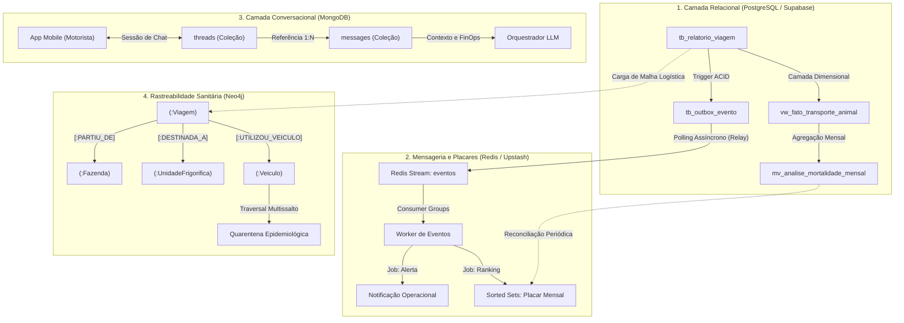

# Efficientia - Arquitetura e Engenharia de Dados

Repositório central de modelagem, migração, mensageria e rotinas de banco de dados do ecossistema **Efficientia**, focado na gestão logística de precisão, rastreabilidade sanitária e bem-estar animal no transporte pecuário da fazenda à unidade frigorífica.

---

## 1. Visão Geral e Escopo Estratégico

A plataforma **Efficientia** gerencia o fluxo operacional e sanitário do transporte de animais vivos, abrangendo o embarque na fazenda, o monitoramento das condições de viagem, o desembarque nas plantas industriais e a auditoria veterinária.

Para garantir alta disponibilidade, integridade transacional rigorosa, baixa latência de mensageria e capacidade analítica avançada, a solução adota uma arquitetura multimodelo especializada, distribuindo as responsabilidades técnicas entre quatro motores de banco de dados complementares:

* **PostgreSQL / Supabase**: Fonte única da verdade transacional (ACID), governança corporativa, catálogo de dados e camada analítica relacional via Star Schema.
* **Redis / Upstash**: Mensageria assíncrona orientada a eventos (Redis Streams), processamento distribuído com Consumer Groups, cache de baixa latência e placares em tempo real (Sorted Sets).
* **MongoDB**: Banco de documentos semiestruturados para suporte conversacional com agentes de Inteligência Artificial (LLM), rastreamento de tokens, latência e observabilidade de suporte.
* **Neo4j**: Banco orientado a grafos (*Property Graph Model*) projetado para rastreabilidade de contato (*Contact Tracing*), travessias de malha pecuária e prevenção de contaminação cruzada entre lotes e veículos.

---

## 2. Estrutura Arquitetural do Repositório

A organização do projeto segue uma segmentação modular estrita por tecnologia e responsabilidade arquitetural:

```text
Efficientia-database/
├── .gitignore                      # Regras de exclusão de credenciais locais, caches e virtuais
├── README.md                       # Documento mestre de arquitetura e integração de dados
│
├── 01_postgresql/                  # Núcleo Transacional (ACID) e Camada Analítica (Supabase)
│   ├── .env.example                # Variáveis de ambiente para conexão com PostgreSQL e Supabase
│   ├── README.md                   # Documentação técnica, schemas relacionais e ordem de execução
│   ├── 01_ddl/                     # Schemas relacionais, tipos enumerados (ENUMs) e DDL de tabelas
│   ├── 02_constraints_and_indexes/ # Chaves estrangeiras, isolamento multi-tenant e índices
│   ├── 03_views/                   # Camada Dimensional (Star Schema) e Materialized Views
│   ├── 04_functions/               # Funções de banco de dados, cálculos de métricas e validações
│   ├── 05_triggers/                # Gatilhos de auditoria temporal e consistência transacional
│   ├── 06_procedures/              # Stored Procedures para transações críticas de aprovação
│   └── 07_dataload/                # Cargas modulares (Catálogo, corporativo, frota e diários)
│
├── 02_redis/                       # Mensageria, Filas e Rankings em Tempo Real (Upstash)
│   ├── .env.example                # Variáveis de ambiente com suporte a TLS (rediss://)
│   ├── README.md                   # Documentação de streams, estruturas ZSET/HSET e CLI operacional
│   ├── requirements.txt            # Dependências do driver redis-py, psycopg e framework de testes
│   ├── main.py                     # CLI unificada para Outbox Relay, Workers e reconciliação
│   ├── src/                        # Implementação de Relay, Consumer Groups e Jobs de alerta
│   └── tests/                      # Suíte de testes automatizados com simulador em memória (fakeredis)
│
├── 03_mongodb/                     # Camada Conversacional e Dados Não Estruturados (IA)
│   ├── README.md                   # Modelagem documental, padrão de referência e guia mongosh
│   ├── 01_schema_validation.js     # Validação estrita de coleções via regras $jsonSchema
│   ├── 02_indexes.js               # Índices únicos e compostos para ordenação temporal e contexto
│   ├── 03_seed_conversations.js    # Carga de sessões de atendimento e diálogos com o orquestrador
│   └── 04_conversational_queries.js # Consultas de contexto para LLM, FinOps e análise de dores
│
└── 04_neo4j/                       # Modelagem em Grafo e Análise de Traversal
    ├── README.md                   # Modelagem do Grafo de Propriedades e rastreabilidade de contato
    ├── 01_schema_constraints.cypher # Restrições de unicidade e índices de propriedades
    ├── 02_seed_data.cypher         # Carga da malha logística pecuária e vetores de transmissão
    └── 03_traversal_queries.cypher  # Consultas de Traversal para detecção de risco epidemiológico
```

---

## 3. Topologia Arquitetural e Fluxo de Integração

O ecossistema interliga os motores de persistência utilizando o padrão **Transactional Outbox**, garantindo consistência eventual confiável sem risco de escrita fantasma ou desincronização entre serviços:



---

## 4. Matriz Estratégica de Armazenamento e Tecnologias

A seleção de cada tecnologia atende aos requisitos funcionais e não funcionais da arquitetura de software da plataforma:

| Motor | Paradigma | Responsabilidade Principal | Garantia de Consistência | Armazenamento Dominante |
| :--- | :--- | :--- | :--- | :--- |
| **PostgreSQL** | Relacional (RDBMS) | Fonte da verdade transacional, cadastros corporativos, diário de viagem e Star Schema | Forte (ACID) | Tabelas normalizadas (3FN) e Views Dimensionais |
| **Redis** | Chave-Valor / Estruturas em Memória | Fila de eventos confiável, processamento assíncrono de alertas e rankings em tempo real | Eventual (AOF / RDB) | Streams, Sorted Sets (ZSET) e Hashes |
| **MongoDB** | Documentos (NoSQL / BSON) | Diálogos com agente de IA, chamadas de ferramentas (*tool calls*), histórico de chat e telemetria | Flexível / Causal | Documentos particionados por referência (`threads`/`messages`) |
| **Neo4j** | Grafo de Propriedades (*Property Graph*) | Análise de contatos cruzados na frota, rotas pecuárias e rastreabilidade epidemiológica | Forte nos nós e arestas (*Index-Free Adjacency*) | Nós (*Labels*), Propriedades e Arestas (*Relationships*) |

---

## 5. Requisitos Globais e Variáveis de Ambiente

Para executar todos os módulos localmente ou em ambiente de desenvolvimento, assegure a presença dos seguintes componentes:

* **PostgreSQL 15+** ou projeto ativo no **Supabase**.
* **Redis 6.2+** ou instância gerenciada no **Upstash** com suporte a conexões TLS (`rediss://`).
* **MongoDB 6.0+** instalado localmente ou cluster no **MongoDB Atlas**, com suporte a `mongosh`.
* **Neo4j 5.0+** (Desktop, Community, Enterprise ou AuraDB) com Cypher Shell habilitado.
* **Python 3.10+** com gerenciador de pacotes `pip` e módulo `venv`.

Cada subdiretório contém seu respectivo arquivo `.env.example`. Assegure que as credenciais corretas estejam configuradas antes da inicialização dos serviços.

---

## 6. Roteiro de Inicialização e Execução Integrada

Para inicializar os bancos de dados de forma ordenada, execute as etapas na sequência numérica correspondente:

1. **Camada Relacional (`01_postgresql/`)**:
   * Executar os scripts na sequência: `01_ddl/` -> `02_constraints_and_indexes/` -> `03_views/` -> `04_functions/` -> `05_triggers/` -> `06_procedures/` -> `07_dataload/`.
   * Estabelece as tabelas de governança, cadastros básicos e carga com 1.500 viagens reais.

2. **Camada de Mensageria e Filas (`02_redis/`)**:
   * Instalar as dependências em ambiente virtual (`pip install -r 02_redis/requirements.txt`).
   * Configurar `02_redis/.env` com as strings de conexão do Supabase e Upstash.
   * Executar `python 02_redis/main.py check` para validar conectividade e `python 02_redis/main.py relay` para iniciar a publicação de eventos.

3. **Camada Conversacional (`03_mongodb/`)**:
   * Abrir o terminal ou `mongosh` no diretório `03_mongodb/`.
   * Executar na ordem: `01_schema_validation.js` -> `02_indexes.js` -> `03_seed_conversations.js` -> `04_conversational_queries.js`.

4. **Camada em Grafo (`04_neo4j/`)**:
   * Abrir o Neo4j Browser ou `cypher-shell`.
   * Executar na ordem: `01_schema_constraints.cypher` -> `02_seed_data.cypher` -> `03_traversal_queries.cypher`.

---

## 7. Governança, Segurança e Conformidade

* **Isolamento Multi-Tenant**: Todas as tabelas transacionais do PostgreSQL e fluxos do Redis segregam dados obrigatoriamente por meio de `empresa_id` (UUIDv4) e padrões de chave com namespace.
* **Idempotência e Concorrência**: Scripts DDL empregam `CREATE OR REPLACE` e `IF NOT EXISTS`; procedures implementam travas transacionais com `FOR UPDATE SKIP LOCKED`.
* **Rastreabilidade Sanitária e Bem-Estar**: O modelo assegura conformidade com as normas do MAPA (Ministério da Agricultura e Pecuária) e Guias de Trânsito Animal (GTA), fornecendo auditoria em tempo real sobre índices de mortalidade e ocorrências de rampa.
